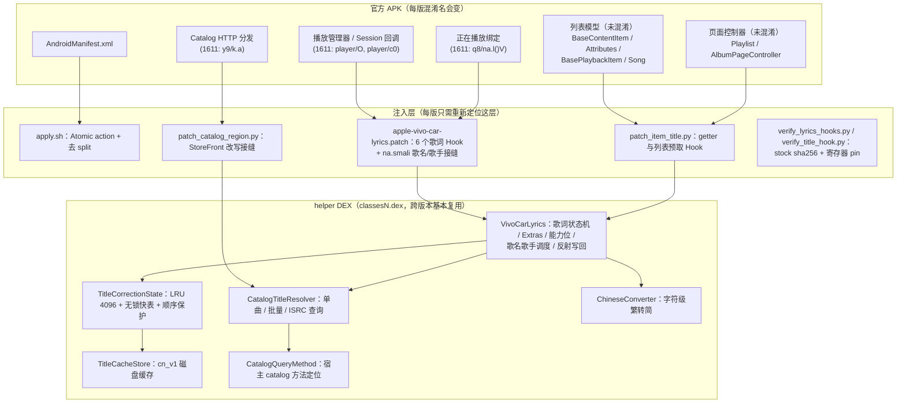
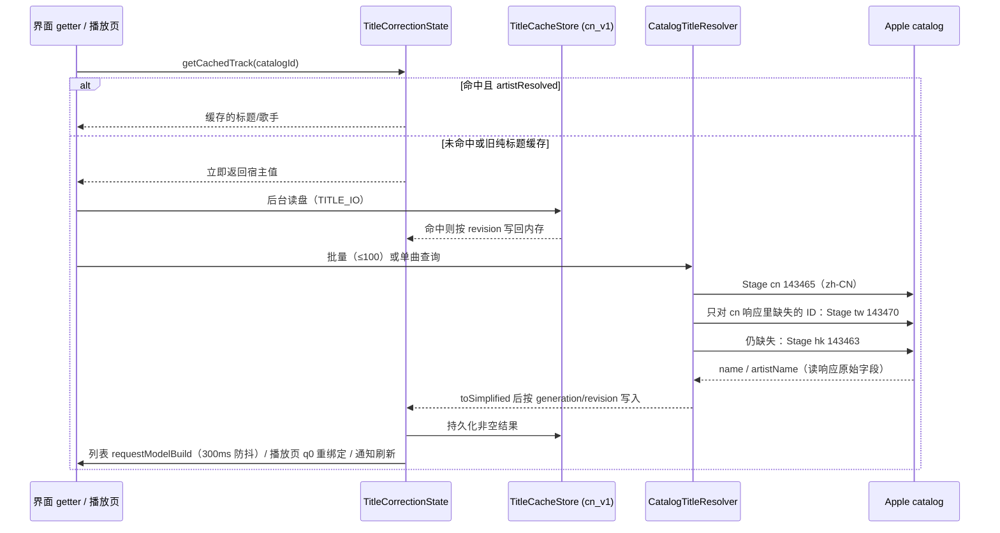

# Apple Music 新版本 APK 适配与升级指南

> **适用场景**：Apple Music 发布新版本后，把车机歌词、原子随身听播控/歌词/进度条，
> 以及歌名/歌手本地化（cn → tw → hk 缺失回退 + 繁转简）移植到新 APK。
>
> **这是升级时唯一需要阅读的文档。** 协议字段（§8）、已验证的死路（§9）、
> 安装签名限制（§10）都已并入本文；旧手册与历史排查记录已从 `docs/` 删除，需要时从 git 历史取回。
>
> **当前适配目标**：Apple Music 7.0.0-beta，versionCode **1611**。
>
> **验证状态**：最新代码为 helper 标记 `vivo-car-cn-track-r53-1611-2026-10-28`
> （r46–r48 在 1609 上依次去掉了旧车机 key、修正 LRC 行格式、把每行改为 CRLF 终结；r49 给出
> 车机封面的车联侧根因并首次从 Apple Music 侧规避；r50 把全部注入点、反射名与 r49 的封面修复
> 移植到 1611；r51 删掉逐句空 Bundle 心跳；r52 撤回 r50 的封面位图剥离（仪表封面回归，代价见 §8.1）；
> r53 按 skill 规范把封面 URL 归一化成 480px 变体，见 §8.1 与 §9）。
> 最新发布的构建是 Build #170（r47，1609），CI 已通过。
> r49–r51 都只通过了 CI 校验与源码/字节码比对，**尚未实机验证**。r50 的 1611 构建为 Build #173
> （Release `v1.0.0-build-173`）：CI 全绿，并在签名后的 APK 上复核了六个歌词钩子、标题/歌手接缝、
> 目录地区 seam、歌名/歌手 getter 与车机封面钩子（`out/report/verified-*.txt`）。
> r51 的构建为 Build #174（Release `v1.0.0-build-174`），成品 helper DEX 里已确认 marker 是
> `r51-1611`、且 `publishLineExtras` / `AtomicActionClearTask` 都不存在；r52 撤回封面剥离，构建号见后。
> Build #155 的实机验证只覆盖 1607 的**歌名**移植；r38（Build #83）的车机歌词、
> 原子随身听歌词和进度条已于 2026-09-04 实车确认。CI 成功不等于实机验证。
>
> **AM++ 路线已废弃（2026-10-13）**：仓库里已**删除** `cloud-patch/ampp/**`、
> `embed-ampp.sh`、`test_embed_build.py`、`docs/AMPP_INTEGRATION.zh-CN.md`，
> 以及 workflow 的 `embed_ampp` / `standalone_module` 输入和 NPatch 步骤。
> 现行流程只有一个 `rebuild` 输入（见 §5）。

---

## 1. 架构与设计原则

只做静态 smali 注入，再追加一个独立的 helper DEX，不依赖任何 Hook 框架。



### 1.1 升级工作量在哪里

- helper 源码在 `cloud-patch/java/com/apple/android/music/player/`，由 `rebuild.sh` 用
  `javac --release 8` + `d8` 编译成新的 `classesN.dex` 追加进 APK。它是纯 Java 代码，
  通常不需要重写。
- **但 helper 里有大量按版本硬编码的反射名**（见 §4）。它们不会被 smali 校验脚本覆盖，
  名字变了也只会静默失效。每个新版本都要逐项核对。
- 需要重新定位的 smali 注入点分 5 类（§2）。

### 1.2 r38 冻结基线（不可破坏）

- 6 个歌词 Hook 保持原语义。车机、仪表和原子随身听**共用**
  `vivomusicmix.extra.lrc_change` 会话 extras 事件（整首 LRC，车联自己按时间切行）。
- 在原生 MediaItem 的 metadata extras 上**原位 OR** `support_event |= 7|8|16`。
- `publishMetadata()` 保持 no-op。歌名/歌手修正**永远不重发** MediaItem、
  MediaMetadata、PlaybackState 或封面。
- 不做 LRC 分页、不发布 `ucar.*`、不改车联。仪表盘截断和封面重载是车联侧问题。

---

## 2. 必须重新定位的注入点

所有目标都断言位于 `smali_classes2`，并用 stock sha256、寄存器、locals 数固定。
**新版本里 sha256 一定会变**：确认语义一致后再更新 pin，不要为了让 CI 变绿而放宽断言。

### 注入点 1：`AndroidManifest.xml`（`apply.sh` 内联 Python）

- 给 `com.apple.android.music.player.MediaPlaybackService` 的 intent-filter 追加
  `com.vivo.musicwidgetmix.support.service`，让原子随身听加载合作控制器 `c0`。
- 要求该服务为 `exported="true"`，且 Atomic action 与
  `android.media.browse.MediaBrowserService`、`androidx.media3.session.MediaSessionService`、
  `android.intent.action.MEDIA_BUTTON` 在**同一个** filter 里，全 manifest 只出现一次
  （`rebuild.sh` 会对最终 APK 再验一次）。
- 删除 `isSplitRequired` / `requiredSplitTypes` / `splitTypes` 以及名字含 `split` 的
  meta-data，同时从 `split_config.*` 注入 `lib/`，生成单包，避免 `-28` 安装错误。

### 注入点 2：播放器生命周期，6 个歌词 Hook

涉及 `apple-vivo-car-lyrics.patch` 与 `verify_lyrics_hooks.py`（`SPECS` 记录签名、
寄存器、stock hash 和前后锚点指令）。

| Hook | 1611 位置 | 1609（历史） | 1607（历史） |
| --- | --- | --- | --- |
| `onNativeMediaItem(p1)` | `O.P(Lz3/w;I)V`，`if-nez p2, :cond_4` 之后 | `P.P(Lz3/w;I)V` | `S.P(Lz3/v;I)V` |
| `onCurrentItemChanged(p0, p3)` | `O.onCurrentItemChanged`，空检查之后 | `P` | `S` |
| `onMetadataUpdated(p0, p2)` | `O.onMetadataUpdated`，空检查之后 | `P` | `S` |
| `onPlaybackError(p0)` | `O.onPlaybackError`，空检查之后 | `P` | `S` |
| `onSeek(p0, p1, p2)` | `O.seekTo(J)V`，`seekToPosition(J)` 之后 | `P` | `S` |
| `onAtomicControllerConnected(v0)` | `c0.o(LJ4/k2;LJ4/k2$e;)V`，`.locals 0→1`，从 `k2$e.a:K4/B$b → .a:K4/B$c → K4/B$d.a:String` 取包名 | `d0.o(LJ4/g2;…)` | `e0.o(LJ4/f2;…)` |

定位方法：
- **播放管理器**：实现了 `MediaPlayerController.Listener`，并且有一个调用
  `seekToPosition(J)` 的 `seekTo(J)V`。
- **Session 回调**：Media3 `onPostConnect` 的混淆实现，第二个参数是 `…$e`
  （ControllerInfo）。分析报告里的 `controller-info-candidates.txt` 会列出候选。

### 注入点 3：正在播放页的歌名与歌手接缝（`q8/na.l()V`）

正在播放页通过生成的 binding 直接给 TextView 赋值。`verify_title_hook.py` 固定：
- `.locals 58` 不变，整个方法的 stock code sha256 不变
- 标题控件 `Lq8/ma;->o0`、歌手控件 `Lq8/ma;->n0`
- `LI2/e;->a` 赋值和 `Lq8/T1;->b` 的显式赋值

```smali
# 歌名：复用已确认失活的 v39..v41
move-object/16 v41, v39
move-object/from16 v39, v1
move-object/from16 v40, v8
invoke-static/range {v39 .. v41}, Lcom/apple/android/music/player/VivoCarLyrics;->correctPlayerTitle(Ljava/lang/Object;Ljava/lang/Object;Ljava/lang/CharSequence;)Ljava/lang/CharSequence;
move-result-object v39
# 歌手：同一模式，作用于 a1.y0(PlaybackItem) 的结果，使用 v52..v54
invoke-static/range {v52 .. v54}, …->correctPlayerArtist(…)
```

- 歌手来自 `player.a1.y0(PlaybackItem)`（1607 为 `e1.y0`），它走的是
  `getNowPlayingSubtitle()` / `getSubTitle()`，**不会**调用 `getArtistName()`。
  所以只 Hook `getArtistName()` 时，播放页歌手不会变。
- 借用寄存器前必须确认它的下一次使用是写入：v40 的下一次使用是
  `cmp-long v40, v43, v22`，v52/v53 是 `and-long v52, v35, v28`。这两个锚点由脚本断言。
  新版本必须重新做这个活性分析。
- `correctPlayerArtist` 遇到 `isShowComposer()` 或 `getContentType()==9` 时保留宿主值。

### 注入点 4：模型 getter 与列表预取（`patch_item_title.py`）

这些类未被混淆，跨版本通常稳定，但方法体的 sha256 仍然需要重新确认。

| 类 | 方法 | 注入 |
| --- | --- | --- |
| `model/BaseContentItem` | `getTitle()` / `getArtistName()` | `resolveItemTitle` / `resolveItemArtist(p0, value)`，`.locals 0→1` |
| `mediaapi/models/internals/Attributes` | `getName()` / `getArtistName()` | 同上，并用 `iput-object` 写回 `name` / `artistName` |
| `model/BasePlaybackItem` | `getArtistName()`（字段属主为 `BaseContentItem->artistName`） | `resolveItemArtist` |
| `model/BasePlaybackItem` | `getNowPlayingSubtitle()` | `.locals 2→3`，receiver 存入 v2，在返回处调用 `resolveItemArtist` |
| `model/Song` | `getSubTitle()` | `.locals 1→2`，receiver 存入 v1，**只修正** `artistName` 回退分支，显式副标题与专辑名不动 |
| `collection/mediaapi/controller/PlaylistPageController` | `addTrackModel(MediaEntity;I)` | 入口调用 `onPlaylistTrack(p0, p1)` |
| `collection/mediaapi/controller/AlbumPageController` | `getItemTitle(MediaEntity;)` | 入口调用 `onPlaylistTrack(p0, p1)` |

### 注入点 5：Catalog 请求 StoreFront 改写（`patch_catalog_region.py`）

- 1609 位置：`y9/k.smali` 中的
  `a(String;String;ZLjava/util/LinkedHashMap;Ljava/util/Map;Lkk/C;Lhi/c;)Object`。
  同时固定整个文件和方法代码的 sha256。
- 在 `.locals 2` 之后注入：
  ```smali
  invoke-static {p1, p4, p5}, Lcom/apple/android/music/player/CatalogTitleResolver;->correctCatalogRequest(Ljava/lang/String;Ljava/util/LinkedHashMap;Ljava/util/Map;)Ljava/lang/String;
  move-result-object p1
  ```
- 只改写携带 resolver 自有 token 参数 `vivo_title_catalog_request` 的请求，而且 token
  必须仍在 live 表中、path 与 selector 必须完全匹配。改写内容是 path
  `/v1/catalog/<sf>/songs`、`l`、`Accept-Language`，以及
  `X-Apple-Store-Front` / `X-Apple-Request-Store-Front` 的前缀。
  账号、播放鉴权、歌词请求原样通过。
- 定位方法：找组装 URL、query 参数和 header 并调用 `kk.C`（OkHttp 客户端）的
  suspend 分发方法。新版本中 `y9/k`、`kk/C`、`hi/c` 都可能改名。

---

## 3. 歌名/歌手本地化的数据流

### 3.1 查询与回退



- 回退条件是**某个 ID 不在 cn 响应里**，不是“cn 返回了英文名”。cn 只要返回了，
  即使是原名也被采用。tw/hk 阶段出错时，返回已累积的部分结果。
- 单曲路径：`queryTrack` 先按 cn ID 查，失败再走 ISRC：用账号 StoreFront 做一次
  无 token 的身份探测，然后在 cn 上做 `filter[isrc]`。账号区的结果只用于身份，
  不作为本地化结果。返回 null 时，再走 `batchQueryTracks` 的三区回退。
- 查询缺失或失败：**歌名**保留宿主显示。**歌手**会把宿主原值做一次繁转简
  （`resolveItemArtist` / `onPlaylistTrack`）。这与歌名不一致，但是有意保留的行为，不要“修正”。
- 列表预取只对歌曲类型发请求（`getContentType()` 为 1 或 36；或 `PlayParams.getKind()`
  是 `songs`/`song`）。类型未知的对象按老行为处理。**失败缓存**：只有 cn/tw/hk 三区都
  正常应答、且结果里确实没有该 ID 时，才把它记入 6 小时冷却表（上限 4096）；部分结果
  不记录。解析器通过 `BatchTrackCallback.onTracks(tracks, complete)` 的 `complete`
  参数告知是否为完整结果。
- 单曲回退**不再重复查 cn**（cn 已经失败过），只走 tw → hk。请求超过 15 秒截止时间后
  不再派发新的地区查询；已在途的迟到结果只写入内存与磁盘缓存，不改界面、不重建列表，
  下次绑定同一首歌时直接使用。
- 歌手名使用目录返回的 `artistName`，不做机器翻译。

### 3.2 缓存

- 内存：access-order LRU，**4096** 项；另有 `ConcurrentHashMap fastTrackCache`
  作为主线程无锁快表。`artistResolved` 用来区分旧纯标题缓存和完整查询结果。
- 磁盘：应用 `getFilesDir()/vivo-car-title-cn-v1.properties`，命名空间 `cn_v1`、
  schema 1、最多 4096 项、TTL 30 天、单值最长 2048、文件上限 4 MB。
  写入时先写临时文件，再用 `ATOMIC_MOVE` 替换；兼容旧的 `\t` 复合格式。
  空标题且空歌手的结果不落盘。
- 顺序保护：单曲结果比对 generation / queueId / catalogId，批量和读盘结果比对
  revision。旧批次或旧磁盘回读不能覆盖较新的完整结果。

### 3.3 繁转简（`ChineseConverter`）

- 字符级映射：2965 个 BMP 繁→简字符对，有序数组 + 二分查找，不依赖 OpenCC。
- **局限**：只做单字映射，没有词组和异体字上下文，所以不能保证“100% 简体”或
  地区用词转换。每次调用会 `toCharArray()`，并非零分配。

---

## 4. 按版本硬编码的反射名清单（每版必须逐项核对）

这些名字**不在** smali 校验脚本的覆盖范围内，失效时只会静默回退到宿主显示。
请用 CI 分析报告里的 jadx/smali 逐项核对，并在本表补充新版本一列。

| 用途 | 位置 | 1609 | 1607 |
| --- | --- | --- | --- |
| 元数据 / MediaItem 类 | `writeCorrectedTrack` | `z3.y`（标题 `a`、歌手 `b`，CharSequence）/ `z3.w` | `z3.x` / `z3.v` |
| 元数据 Extras 字段 | `getMetadataExtras` | `J`（回退 `I`） | 同 |
| MediaItem → 元数据字段 | `applyTitleCorrection` / `currentPlaybackItem` | `d` | 同 |
| 管理器当前 MediaItem | `currentMediaItem` | `c()`（回退 `a()`） | 同 |
| 元数据 → PlaybackItem 转换器 | `currentPlaybackItem` 依次探测 `player.Q` / `P` / `O` 的 static `b(metadata)` | `O.b(Lz3/y;)` | `Q` 或 `P` |
| 通知刷新链 | `refreshTitleNotification` | `manager.a.b` → session，`session.a.f` → service，`service.y == session`，`session.c() == manager`，`J4.Z2.g(J4.g2, boolean)` | `J4.Y2` / `J4.f2` |
| 播放页重绑定 | `applyTitleCorrectionFromState` | `q8.ma.q0(PlaybackItem)`（回退 `setItem`） | 同 |
| 正在播放绑定自持的播放器引用 | `q8.ma.r0(Lcom/apple/android/music/player/a1;)V` | **不是** PlaybackItem setter，别拿它重绑定 | — |
| 会话 extras 发布 | `publishSessionExtras` | `invokeRequired(sessionManager, "j", extras)` | 同 |
| Application 获取 | `appleApplication` | `AppleMusicApplication$a.c()` / `a()` | 同 |
| Catalog API 实例 | `findCatalogApi` | `MediaApiRepositoryHolder.Companion.getMediaApi()` | 同 |
| Catalog 方法 | `CatalogQueryMethod` | 非 static `Object m(String, Map, Continuation)`，候选名 `F`，失败时 `findUnique` | 改名表 `s8.F→x`、`u8.E→v`、`w9.Q/w9.a→F` |
| Continuation 上下文 | `CatalogTitleResolver.emptyContext` | `kotlin.coroutines.EmptyCoroutineContext` | 回退 `fi.f` |
| Result 失败类型 | `CatalogTitleResolver.failureOf` | `kotlin.Result$Failure` | 回退 `bi.q$a` |
| 正在播放 StoreMediaItem | `writeCorrectedTrack` | `playback.model.StoreMediaItem`（`title` / `artistName`） | 同 |

> 注意：1611 中 `player.O` 是**播放管理器**、`player.N` 才是 metadata → PlaybackItem 转换器。转换器探测会依次试 `N`、`Q`、`P`、`O`，只要它们
> 恰好也有一个参数兼容的 static `b(...)`，就会拿错对象。新版本要确认探测顺序，
> 并校验返回类型是 `PlaybackItem`（helper 已强制这一点）。
>
> 上表里能静态确认的条目已由 `cloud-patch/verify_reflection_names.py` 覆盖：
> `apply.sh` 在打补丁前预检，`rebuild.sh` 在最终 APK 上再验一次，结果写入
> `out/report/verified-reflection-names.txt`。名字变了 CI 会直接失败，而不是静默失效。
> 新增硬编码反射名时，同步往这个脚本加一条断言。
> `AppleMusicApplication$a` 不在分析产物里，脚本只提示、不阻塞。

---

## 5. 升级步骤


> 本机（Mac）**不安装**任何构建工具（apktool / jadx / Java / Android SDK / pip 包）。
> 解包、编译、签名、Java 测试都在 GitHub Actions 里完成。本地只用系统自带的
> `python3`、`unzip`、`grep`、`tar` 做只读检查。

### 步骤 1：更新 payload

1. 把 APKM 中的 `base.apk` 和全部 `split_config.*.apk` 放进 payload 的 `input/splits/`。
2. 重新打包并切片：
   ```bash
   ( cd /tmp/payload && tar -cf /tmp/payload.tar . )
   split -b 20m -d -a 3 /tmp/payload.tar payload.tar.part.
   shasum -a 256 /tmp/payload.tar | sed 's#  .*#  payload.tar#' > payload.sha256
   ```
3. 更新 `.github/workflows/apk-pipeline.yml` 中的 `APK_NAME`。

### 步骤 2：CI 分析

```bash
export https_proxy=http://127.0.0.1:7897 http_proxy=http://127.0.0.1:7897
git push origin <branch>
# 确认推送已经落地，再触发构建
[ "$(git rev-parse HEAD)" = "$(git rev-parse origin/<branch>)" ] || echo "push 未生效"
gh workflow run "APK analysis and rebuild" --ref <branch> -f rebuild=false
gh run watch <run-id>
gh run download <run-id> -n apple-music-analysis -D /tmp/report
```

`focused-sources.tar.gz` 里有 `q8`、`J4`、`w9`、`x9`、`y9`、`kk`、`fi`、`gi`、`bi`、
`kotlin/coroutines`、`player/*` 以及模型类的完整 smali/jadx 源码。
macOS 文件系统大小写不敏感（`na.smali` 和 `Na.smali` 会互相覆盖），所以用
`tar -xOzf … <path>` 按单个文件读取，不要整包解压。

### 步骤 3：定位

1. 播放管理器：grep `seekToPosition` 和 `onCurrentItemChanged`。
2. MediaItem 发布入口：管理器里参数为 `(Lz3/<MediaItem>;I)V` 的方法。
3. Session 回调：参数为 `(LJ4/<session>;LJ4/<session>$e;)V`，参考
   `controller-info-candidates.txt`。
4. 正在播放绑定：生成的 binding 中调用 `getTitle()` 并给 `CustomTextView`
   赋值的 `l()V`；歌手由 `<player>.y0(PlaybackItem)` 提供。
5. Catalog 分发：`y9/k` 的等价类。
6. 模型类和页面控制器：确认路径与方法签名不变。
7. 按 §4 的清单逐项核对反射名。

### 步骤 4：更新补丁与校验脚本

| 文件 | 需要更新的内容 |
| --- | --- |
| `cloud-patch/apple-vivo-car-lyrics.patch` | 管理器、Session 回调、`na.smali` 的 hunk（`patch --fuzz=0`，必须严格匹配） |
| `cloud-patch/apply.sh` | `manager_target`、`connection_target` 路径 |
| `cloud-patch/verify_lyrics_hooks.py` | `MANAGER`、`CONNECTION`、`ATOMIC_BODY`、`SPECS`（签名、寄存器、stock hash、锚点） |
| `cloud-patch/verify_title_hook.py` | 目标类/方法、locals、stock hash、借用寄存器的活性锚点、控件字段 |
| `cloud-patch/patch_catalog_region.py` | `y9/k` 路径、方法签名、文件和代码 sha256 |
| `cloud-patch/patch_item_title.py` | `ENTRY_PINS`、`ARTIST_RETURN_SPECS`（locals 和 receiver 寄存器） |
| `cloud-patch/rebuild.sh` | `BUILD_MARKER`（`HELPER_MARKERS`）、最终 smali 路径报告 |
| `VivoCarLyrics.java` 等 helper | §4 的反射名，以及 `BUILD_MARKER` |
| `cloud-patch/tests/**` | 同步测试中的类名和 stub（`title_integration` 里的 O/P/Q、`J4/Z2`、`g2`、`z3/w`、`y`） |

### 步骤 5：测试

CI 第一步会运行（Java 测试只在 CI 中运行）：
```bash
bash cloud-patch/tests/run-java-tests.sh
python3 cloud-patch/tests/verify_source_contract.py
python3 -m unittest discover -s cloud-patch/tests -p 'test_*.py' -v
```
本地只跑 Python 部分（系统 `python3`，无第三方依赖）：
`verify_source_contract.py` 加 `test_catalog_region.py`、`test_item_title_patch.py`、
`test_lyrics_hooks.py`、`test_p0_classes.py`、`test_title_hook.py`。

### 步骤 6：CI 重建

```bash
export https_proxy=http://127.0.0.1:7897 http_proxy=http://127.0.0.1:7897
git push origin <branch>
[ "$(git rev-parse HEAD)" = "$(git rev-parse origin/<branch>)" ] || echo "push 未生效"
gh workflow run "APK analysis and rebuild" --ref <branch> -f rebuild=true
```

- `apply.sh` 依次执行：unpatched 预检 → 应用 patch → 校验 → catalog / item 注入 →
  manifest。`rebuild.sh` 依次执行：回编译 → 编译 helper DEX → 注入 `lib/` → 对齐 →
  用固定证书签名（pin：`config/signing-cert-sha256.txt`）→ 对最终 APK 重新解包，
  再跑全部 verify 脚本和标记检查。
- 成功后发布 Release `v1.0.0-build-<run_number>`。构建**不是逐字节可复现的**，
  判断是否为同一构建要看 helper 标记和 verify 报告，不要看 APK sha256。

### 步骤 7：实机回归

```bash
adb install -r apple-music-vivo-car-lyrics-debug.apk
adb logcat -s VivoCarTitle
```

- [ ] 正常播放；无损/杜比全景声正常。
- [ ] 歌单、专辑页的歌名和**歌手**在预取后刷新为简体，滚动不卡顿。
- [ ] 正在播放页的歌名和**歌手**（来自 `a1.y0` 副标题）正确；古典作曲者和
      contentType 9 的格式化副标题保持宿主样式。
- [ ] 从歌单、专辑、搜索三个入口播放同一首歌，歌手显示一致。
- [ ] 通知栏的标题和歌手正确，且没有重发 MediaItem（原子随身听进度条不丢失）。
- [ ] 快速切歌时没有串名；旧的纯标题缓存会补查到歌手。
- [ ] 断网或查询失败时保留宿主显示，不崩溃。
- [ ] 车机：歌词同步滚动，切句时封面不刷新。
- [ ] 原子随身听：歌词同步；进度条有时长、会走动、可以拖动 seek。

---

## 6. 避坑铁律

| 坑 | 后果 | 铁律 |
| --- | --- | --- |
| 重发 MediaItem | 原子随身听进度条变 `--:--`，车机封面闪烁 | `publishMetadata` 保持 no-op；歌名/歌手只原位改字段，再刷新 stock 通知 |
| 漏掉能力位 | 原子随身听进度条显示 `--:--` | 原位 OR `7\|8\|16`，16 不可少 |
| 只 Hook `getArtistName` | 播放页歌手不变 | 播放页歌手来自 `y0` 副标题，必须在 binding 接缝修正 |
| 借用了仍然存活的寄存器 | 运行时数据错乱 | 只能借用下一次使用是写入的寄存器，并用锚点断言 |
| 放宽 pin 让 CI 变绿 | 改错位置也能通过 | 先确认语义，再更新 sha256 |
| 网络请求被全局改写 | 账号或鉴权异常 | 只改写带 live token 的请求 |
| 异步结果串到别的歌 | 快速切歌时显示错名 | 比对 generation / queueId / catalogId / revision |
| 反射名静默失效 | 功能“没生效”但不报错 | 每个版本逐项核对 §4，并看 logcat |
| macOS 大小写不敏感 | smali 文件互相覆盖 | 用 `tar -xOzf` 读单个文件，或在 Linux CI 中处理 |
| 把 CI 成功当成实机验证 | 误报“已修复” | 实机回归通过前一律标注“未验证” |

---

## 7. 文件索引

**当前主路径**
- `cloud-patch/java/com/apple/android/music/player/VivoCarLyrics.java`：总状态机。
  负责歌词分发、能力位、歌名歌手调度、预取、列表刷新和反射写回。
- `CatalogTitleResolver.java`：单曲/批量/ISRC 查询，cn → tw → hk 缺失回退，
  以及 `correctCatalogRequest` 接缝。
- `CatalogQueryMethod.java`：定位宿主的 catalog suspend 方法（按类缓存命中与缺失）。
- `TitleCorrectionState.java`：内存 LRU（4096）、无锁快表、请求顺序保护。
- `TitleCacheStore.java`：`cn_v1` 磁盘缓存（4096 项，30 天），读入时统一转简体。
- `ChineseConverter.java`：字符级繁转简（先扫描，命中才分配数组）。
- `ClusterLyricsPaginator.java`：仪表盘歌词分页（r38 基线，不扩展）。
- `cloud-patch/apple-vivo-car-lyrics.patch`、`apply.sh`、`rebuild.sh`。
- `cloud-patch/verify_lyrics_hooks.py`、`verify_title_hook.py`、
  `verify_reflection_names.py`（§4 反射名的 CI 预检）、
  `patch_item_title.py`、`patch_catalog_region.py`。
- `cloud-patch/tests/`：`run-java-tests.sh`（只在 CI 运行）、
  `verify_source_contract.py`、`test_*.py`、`com/**`、`title_integration/`、
  `catalog_query/`。

**已废弃（AM++ 路线，已于 2026-10-13 从仓库删除）**
- `cloud-patch/ampp/**`、`cloud-patch/embed-ampp.sh`、
  `cloud-patch/tests/test_embed_build.py`、`docs/AMPP_INTEGRATION.zh-CN.md`；
  workflow 的 `embed_ampp` / `standalone_module` 输入与 NPatch / AM++ 下载步骤。
  需要时从 git 历史取回，**不要**再适配或重新启用。
- 已删除的历史文档（2026-10-14 合并进本文）：`APK_UPDATE_GUIDE`（旧手册）、`KNOWN_ISSUES`、
  `ARTIST_LOCALIZATION_1609`、`AI_HANDOFF_PROMPT`、`HANDOFF_ARTIST_LOCALIZATION_ISSUE`、
  `STANDALONE_TITLE_CORRECTION_PLAN`。其中的 6.5.2 / 1607 映射只有历史价值。

---

## 8. vivo 协议字段（跨版本稳定，必须原样照抄）

### 8.1 车机（JoviInCar）：没有单独的通道

- 车机和仪表的歌词**完全来自** 8.2(c) 的 `lrc_change` 整首 LRC 事件：车联 `eg/l.java onExtrasChanged()`
  消费它，再由 `fg/l.java` 按播放时间切行。
- 旧的 `music.media.extras.LYRIC` / `LYRIC_IS_ALLOWED` / `NOTICE_CAR` 三个 key，车联 6.0.8.3 从不读取
  （只在常量类 `aa/b.java` 里定义过）。**r46（2026-10-14）已删除**，不再兼容旧车联，契约测试禁止加回来。
- **r51（2026-10-26）删掉了逐句更新**：此前每换一句都会调用一次宿主的“设置会话 Extras”
  （1609：`sessionManager.j(Bundle)`），发的是空 Bundle。`setExtras` 不是整包替换——`C13660l0.j(Bundle)`
  先把已存的 `f9117D` `putAll` 进去、再叠加入参，`C2786g2.m4607e` 把合并后的包存回——所以空包只能把上一次的
  `lrc_change` 原样再广播一次，而车联 `eg/l.java` 丢弃空 lyric 事件、`jg/e.h0` 又按字符串去重，等于空转；
  同时开源 skill `7tattoo/vivo-car-atomic-lyrics` 记录到部分组件版本会把“空 Bundle 的 setExtras”读成
  “本曲无歌词”。空转没有收益、只有风险，因此移除。**现在只有换曲清场、整首 LRC 事件与 25s 心跳会写
  session Extras**；车机、仪表和原子都从整首 LRC 自己切行，不需要逐句事件。
- 车机滚动歌词只有一条通路：车联把 `lrc_change` 的整首 LRC **原样**经 AIDL `ILauncherManager.i5`
  （transact 39，Bundle key `key_lyrics_whole`，只带包名不带 mediaId）交给桌面/车机端，由车机端自己解析。
  逐句通道（`x3`，transact 40）送的是已剥掉时间戳的纯文本。所以屏幕上出现的时间戳一定是车机端解析我们
  这份 LRC 的结果 → **每一行必须是一行可解析的 `[mm:ss.cc]文本`**。
- **r48 的行终结**：每一行（含最后一行）必须以 `\r\n` 终结，不能只用 `\n` 分隔。依据是车联
  读取器 `ub/e.e(String)` 的 smali（classes3.dex，已反汇编核对）：取一行正文时，若该行末字符既不是
  `\n` 也不是 `\r`，它走的是 `substring(rightPoint+1, length-1)`——**每行都被吃掉最后一个字符**；
  只由一个字符组成的行因此变成空串被整行丢弃。一旦整份 LRC 的行全部变空，`ub.e` 会走
  “把所有原始行当歌词”的兜底分支，带 `[mm:ss.cc]` 前缀的原文就这样出现在屏幕上（“车机歌词有时间戳”）。
  对 `\r\n` 行，同一段 smali 恰好剥掉尾部 `\r`，正文完整——这正是它被写出来时面对的格式
  （原子 `com/vivo/musicwidgetmix/lrc/e.java` 是同一份代码的正确变体，可对照）。`verify_source_contract`
  已锁定 `LRC_ROW_SEPARATOR`、`append(LRC_ROW_SEPARATOR)` 与“不存在 `append('\n')`”。
- **r47 的行格式约束**（`consumeRawLyrics` / `publishLines` / `sanitizeLineText`）：
  分钟只能 1–2 位（车联解析器只认这个；`[100:00.00]` 取不到时间点，该行被丢弃，全丢弃就走上面的
  原始行兜底，所以仍然要钳位），`formatTime` 逐行钳到 `LRC_MAX_MILLIS`；**不压缩整条时间轴**——
  `lyricsState.times` 同时喂给车机分页器和原子歌词，按比例挤压会连带改变这两条通路的节奏，
  而超长曲目本身极少。一行一个物理行（剥离 `<br>`、U+2028/9、行内 `[mm:ss]`/`<mm:ss.xx>` 标记，
  `^` 换成全角 `＾` 而不是删掉——车联把 `^` 直接当换行）；`[ti:]`/`[ar:]`/`[offset:]` 这类 LRC
  头标签**整行匹配**才丢弃，含括号的正文不动；无时间戳的行各自占一行，不能因为都是 time=0 被合并
  成一句（纯未同步歌词曾因此塌成一行）；时间乱序时只做稳定排序 + 合并同时间行，**不再**把整首歌
  重排成 `index*step`。
- **车机专辑图串台：车联侧根因已定死；r50 曾规避，r52 撤回**（r47 的“闪一下”结论不准确，r48 用
  smali 定死了机制）：车联封面走 `jg/e.X(String,q9/a)` → 位图交给 `wb/f.MusicCoverStore` 异步压缩
  （PNG q100，单飞 + 单待发槽），回调 `jg/e$d.a(String player, String songId, String url, Bitmap)`
  **只比较包名**（`TextUtils.equals(p1, e.f25617j)`），`songId` 与入队时捕获的 `q9/a` 都不参与校验，
  于是上一首的压缩结果照样执行 `jg/e.g(g)`：把旧 URL 写进 holder `f25631x`，再
  `ILauncherManager.A3(旧URL, ...)` 推给车机——切歌后车机封面慢一拍。
  ```
  r50 的规避 = 在 J4/t.n 入口置空内联位图（const/4 p5, 0x0）→ jg/e.X 返回 false → 跳过 MusicCoverStore
  r52 的撤回 = 恢复内联位图；原因是它把仪表封面整块打断了（下面这段是车联 6.0.8.3 的实证）
  ```
  **仪表为什么必须要有内联位图**：`HudManager`（`gg/d.java`）只从 `CarMusicInfo.getCoverBitmap()`
  取图，而该位图来自 `q9/a.a()` = metadata 的 `DISPLAY_ICON || ALBUM_ART || ART`；为空时它回落到
  `x()`（URL 下载缓存）——但 `e0()` 的顺序是「先 `O()` 通知、后 `j0()` 拉封面」，通知发生时缓存还是
  上一首的或空的；又因为 `CarMusicInfo.equals` **不比较位图**，`M()` 与 `HudManager.l()` 都按
  `equals` 去重，下载完成后没有任何二次通知（封面的 `d(bitmap,...)` 回调仪表根本没实现，
  它只重写了 `g/h/i/j`），于是整首停在默认图标，能否显示取决于缓存是否已热——就是“开盲盒”。
  **结论（不可兼得）**：位图留在 metadata → 仪表稳定，车机卡片在切歌后约 2s 内可能仍是上一张；
  位图剥离 → 车机卡片稳定，仪表随机丢图。r52 选前者（整块丢显示比慢一拍更严重）。
  要两者兼得，只能让车联在封面就绪后再通知一次——那需要改 `com.vivo.car.networking` 或 vivo 私钥。
  改车联本身（在 `jg/e$d.a` 里比对 `songId`）仍然需要 vivo 私钥，仍然是不可行的方向。
- **r53：按 skill 的投递规范归一化封面 URL**。卡片和原子是**另一个进程按 URL 自己下图片**
  （见 §8.4），1–2 MB 的原图会下载超时、界面保留旧图。所以 `J4/t.n` 入口多挂一个
  `VivoCarLyrics.coverUri(Uri)`（`patch_cover_uri.py`）：只改 URL 最后一段
  （`1000x1000bb.jpg` → `480x480bb.jpg`），其它形状原样返回。仪表吃的是内联位图，不受影响；
  条带化之后的 URL 也让车联的 `s(url)` 下载更快、缓存更早热。

### 8.2 原子随身听

**(a) Manifest action**：见注入点 1。`com.vivo.musicwidgetmix.support.service` 让原子选择**合作控制器**
`c0`，歌词事件只有它处理，**不能撤**。

**(b) MediaMetadata Extras（原生 MediaItem 发布路径中原位 OR）**

```text
vivomusicmix.media.metadata.support_event = 原值 | 7 | 8 | 16   （= 31）
```

| bit | 用途 | 原子 6.2.5.6 源码依据 |
| --- | --- | --- |
| 1 / 2 / 4 | 基础播控（未知应用默认 7） | `getSupportEvent()` 默认值 |
| 8 | 歌词 | `f5/n.java`、`f5/b.java`：`b1.c(P0(), 8)` |
| 16 | 进度条 / seek / 时间显示 | `t4/d0.java` `Y0()/Z0()`：`duration > 0 && b1.c(P0(), 16)` |
| 32 | 自定义颜色 / 互传 | `SettingsMainView`、锁屏组件 |
| 64 | 列表入口 | `MusicControlPanelView`、`f5/w0.java` |
| 128 | 未确认 | `f5/w0.java` |

合作控制器 `c0.k0()` **原样读取**这个值，不会自己补位。通用控制器 `y2` 才会根据
`ACTION_SEEK_TO` 自己算出 23。所以走合作路径时少了 16 位，进度条就永远是 `--:--`。

**(c) MediaSession Extras（完整 LRC 事件）**

```text
vivomusicmix.meida.extra.key.action   = "vivomusicmix.extra.lrc_change"（有事件时）/ ""（逐句更新时）
vivomusicmix.extra.key.meidia_id      = 当前公开 android.media.metadata.MEDIA_ID
vivomusicmix.extra.key.lyric          = 完整带时间戳 LRC
```

- `meida` / `meidia` 是协议的**真实拼写**，不能改。
- 切歌时先发一次空歌词事件（`lrc_change` + 新曲 ID + 空 lyric），清掉原子内存里的上一首。
  公开 ID 还没出现时用新队列项的 store ID 兜底；连兜底也没有就发空 ID。
- 原子要求 `meidia_id` 等于当前歌曲（`t4/d0.java E0()/z1()`），否则隐藏歌词；车联只要求非空。
- 25s 心跳（`ATOMIC_KEEPALIVE_MS`）：只用于“组件在播放开始后才连上”的场景，发的是**整首 LRC**（不是空包），
  车联侧会被 `jg/e.h0` 去重（见 §8.1），不要指望它给车机补发。r51 之后它是唯一的高频写入。

### 8.3 vivo 侧参考源码

需要查原子或车联内部逻辑时，运行 workflow **Decompile vivo APK**
（`.github/workflows/vivo-decompile.yml`，输入 `release_tag`、`label`）。

| Release tag | 包 | label |
| --- | --- | --- |
| `atomic-apk-6.2.5.6` | 原子随身听 `com.vivo.musicwidgetmix` 6.2.5.6 | `atomic` |
| `carnetworking-apk-6.0.8.3` | 车联 `com.vivo.car.networking` 6.0.8.3 | `carnetworking` |

```text
原子：controller/c3.java   控制器工厂（按包名 / manifest action 选控制器）
      controller/c0.java   合作控制器：k0() 读 support_event 与 DURATION；内部类 b 处理 lrc_change
      controller/y2.java   通用 MediaSession 控制器：j0() 自算 support_event
      t4/d0.java           Y0()/Z0() 决定进度条是否显示；E0()/z1() 校验 lrc 的 mediaId
      view/SeekBarLayout   refreshPosition()：!isSupportTimeInfo 时显示 --:--
车联：aa/b.java            协议常量
      eg/l.java            onExtrasChanged() 消费 lrc_change；c(MediaMetadata) 读 ucar.* 键
      fg/l.java            WholeLyricManager：按播放位置从整首 LRC 切出当前行
      gg/d.java            HudManager：仪表发送（截断 17 字 + "..."，每次附带封面）
```

原子的 `MediaControllerCompat` 只是 `android.media.session.MediaController` 的薄包装，
compat 层和框架层是同一个 session，不是两条通道。

### 8.4 外部参考实现（`7tattoo/vivo-car-atomic-lyrics`）

这是别人整理的一份 Claude skill（MIT，v1.2.0），把 hachimi / TattooMusic / md3Music / NeriPlayer /
kgka_Music_hl 五个项目的实车适配经验写成方法论。2026-10-26 对照核对过 `SKILL.md`、
`references/protocols.md`、`references/card-cover.md`、`references/projects.md`（未逐行审 `scripts/`）。

**逐字一致、可当独立交叉验证的**：Atomic 五个 key 与 vivo 的错拼（`meida` / `meidia`）、
`support_event = 31 = 7|8|16`、`com.vivo.musicwidgetmix.support.service` action，以及本文 §8.1 的核心
结论——车联 6.0.8.3 不读 `music.media.extras.*`，车机/仪表的歌词来自原子的 `lrc_change` 整首 LRC 事件、
由车机端自己切行。它同样推荐 25s 重发节流，也把“写 `LYRICS_LINE`”“写负状态”列为禁止项。

**已采纳它的规则（r51）**：它把“推空 Bundle 的 `setExtras()`”列为“绝不能做”（说会清空车机已收到的 extras、
已显示歌词消失）。本文 §8.1 在 1609/1611 上量到的是合并语义（`C13660l0.j` + `C2786g2.m4607e`），空包只能把
上一次的 `lrc_change` 原样再广播一次；但结论一致地指向“别发空包”——空转无收益，而它在某些组件版本上会被
读成“本曲无歌词”。**r51 已删除逐句空包**，现在只有换曲清场、整首 LRC 事件与 25s 心跳会写 session Extras。
实机复核点仍保留：切歌瞬间已显示的歌词不应被清掉。

**路线不同、不必对齐的两条**：

- 它主张在 MediaMetadata 写 `ucar.media.metadata.LYRICS_WHOLE`（兼容旧车联）。本项目实测写它要重发
  MediaItem，会把 PlaybackState 打回 `--:--`（r34），所以只保留 `lrc_change`。该 skill 自己的 NeriPlayer
  档案同样写着“metadata 不再携带整段歌词，歌词照走 `lrc_change`”，与本文一致。
- 它的形态是“改 `applicationId` 到白名单包名 + 桥接类 + 5 个稳定 API hook”，跨版本省事；本项目是就地改
  官方 Apple Music 的 smali 接缝，每版必须重新定位（§2）。它说的“Apple Music”是 Flutter 应用 md3Music
  套用该包名，不是官方 APK。

**可以借鉴的封面投递规则**（`references/card-cover.md`；与本项目 §8.1 的“串台”是两条不同的链）。
r52 撤回位图剥离后，内联位图与 `ALBUM_ART_URI` 并存，但**卡片/车机那侧仍然按 URI 自己下载**，这些约束照样适用：

1. 只投 `http(s)`：`content://`、`file://` 卡片侧拉不到，宁可返回 `null`（占位图好过错图/纯色）。
2. URL 里的字面量占位符必须替换（如 `{size}`），否则 404；而这个 404 只发生在卡片进程，自己的日志里看不到。
3. 大图会下载超时 → 同样纯色；投 480px 级别的地址。
4. 负缓存必须带 TTL，不能“一次取不到就永久放弃”。
5. 非空才覆盖封面，只在换曲时清空；歌词刷新时顺手清封面会让卡片闪回纯色。
6. `http` / `https` 的取舍**随组件版本反转**（它自己的两个项目结论相反），必须实测，别照抄。
7. 封面和歌词是两条独立链路：App 内封面正常、卡片纯色很常见，不要因为“歌词通了”就认为封面也通了。

---

## 9. 已验证的死路（不要重试）

| 方案 | 结论 |
| --- | --- |
| 重发 MediaItem（如 `manager.I(mediaItem, 0)`） | 重置 PlaybackState，原子进度条变 `--:--`，车机封面闪烁（r34 实测，已撤销） |
| 往 MediaItem extras 写 `DURATION` 修进度条 | 无意义，时长本来就在；缺的是 support_event 的 16 位 |
| compat token 反射路径、`Token.fromToken` | 方向错误，compat 层不是独立通道 |
| 在 session extras 写 `ucar.media.metadata.LYRICS_WHOLE/LINE` | 车联只从 MediaMetadata 读这两个 key，写在 session extras 无效（r9–r36 分页失败的原因） |
| 通过 MediaMetadata 的 `ucar.*` 单独喂车联 | 歌词加载完成后要重发 MediaItem，等于第一行的死路 |
| 把 LRC 按 ≤20 字分页给仪表 | 原子和车机歌词页读同一个 key，会一起变成碎句，封面重载更频繁。**用户已否决** |
| 给车联和原子发不同的 LRC | 两者都读 `vivomusicmix.extra.key.lyric`，后写覆盖先写；用 mediaId 区分会让原子隐藏歌词 |
| 修仪表截断 / 每句重载封面 | 根因在车联 `gg/d.java`：写死 `substring(0,17)+"..."`；`CarMusicInfo.equals` 包含当前行，每句都会连同封面整包重发。Apple Music 侧没有杠杆；改车联需要 vivo 私钥。不尝试规避，不改车联 |
| 切歌后延迟歌词发布，躲开“旧封面”窗口 | 前提不成立：歌词事件与封面管线无关，延迟只会丢掉切歌后的头一两句歌词（r47 实测后撤销）。`a8.c.c(..., 2000L, ...)` 的 2000 是看门狗不是延迟 |
| 想从 Apple Music 侧修车机“封面是上一首” | **r50 试过、r52 撤回：与仪表互斥**。剥离内联位图（`J4/t.n` 置空）确实让 `jg/e.X` 返回 false、跳过 `MusicCoverStore`，车机卡片稳定；但 `HudManager` 只吃 `CarMusicInfo.getCoverBitmap()`，没有内联位图后仪表整首丢图（`equals` 不比位图 + 无二次通知），见 §8.1。两者不可兼得；要兼得只能改车联。延迟发布、重发 MediaItem 依旧是死路 |
| 用空 Bundle “清除” session extras | Media3 每次 `setExtras` 都会合并已存 extras（`C13660l0.j` + `C2786g2.m4607e`），空包等于重播上一次的 `lrc_change`；车联又丢弃空 lyric 事件。清不掉，别再往这个方向想 |
| 用空 Bundle 的 `setExtras` 逐句“刷新”车机 | 空转：合并语义下车联只会重收同一份 `lrc_change`、再被 `jg/e.h0` 去重；部分组件版本还会把它读成“本曲无歌词”。**r51 已删除**，别再把它加回来 |
| 用重复发布整首 LRC 去“补发”给重连的车机 | 车联 `jg/e.h0` 按字符串完全相等去重，同一份 LRC 重播会被吞掉；它唯一的重取路径读 `ucar.media.metadata.LYRICS_WHOLE`，我们从不发布。所以对**车机**在协议内无法可靠补发。注意区分：**原子**侧仍需要 25s 心跳（`ATOMIC_KEEPALIVE_MS`），那是给组件重连用的，不是给车机补发的手段 |
| 外挂桥接 App（`kuwo-bridge/`，伪装 `cn.kuwo.player`） | 能解决车联识别和控制转发，但拿不到宿主私有的完整同步歌词。改 Apple Music APK 仍是最完整的方案 |
| AM++ / NPatch / LSPosed | 2026-10-13 废弃，歌名歌手修正已完全内置于 helper DEX |

历史版本的教训：r39 只适配了发布方法、漏改当前 MediaItem getter（1607 起为 `c()`，旧版 `a()`），
导致车机和原子都没有歌词。**每个版本都要核对 §4 的全部反射名**，不能只改 smali。

**诊断开关**：`VivoCarLyrics.DIAGNOSTIC_MODE = true` 会在歌词头部输出 D1–D6 诊断行
（token 路径、时长与 support_event、PlaybackState、ucar 键、连接时间）；`TITLE_DEBUG = true`
会在 `VivoCarTitle` tag 下打印逐曲查询日志。两者默认都是 `false`，改为 `true` 后重新构建即可，无需加代码。

---

## 10. 安装与签名限制

- 重建的 APK 使用自有测试签名，**不能覆盖安装**官方 Apple Music。从官方版切换要先卸载，
  已下载的歌曲会被清除。
- 新签名可能影响 Apple 登录、DRM、推送或完整性检查，测试前确认账号可以重新登录。
- 同一固定密钥构建的版本之间可以直接 `adb install -r` 覆盖。

```text
GitHub Secret: ANDROID_SIGNING_KEY_BASE64 / ANDROID_SIGNING_PASSWORD
Key alias:     apple-music-vivo-car-lyrics
证书 SHA-256:  见 config/signing-cert-sha256.txt（rebuild.sh 会校验，换了密钥构建直接失败）
```

密钥和密码只存在 GitHub Secrets 里，不进 Git。私钥丢失后，新构建将无法覆盖旧安装。
